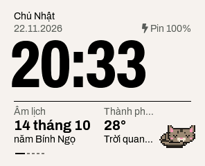
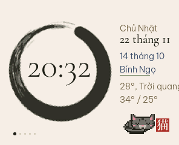

# MeowBox: open firmware for the OSTB xiaozhi-3st speaker

An ESP32-S3 "AI chatbot" speaker sold in Vietnam, freed from its closed-source vendor firmware. It now
runs **MeowBox**, our own firmware: a desk clock with the Vietnamese lunar calendar and weather, alarms,
internet radio (including VOV and YouTube through a PC relay), a notification speaker, a PC companion
screen and a pixel-art cat that codes along with Claude Code on the PC (Meow Coding), all configured from a web page on the speaker, in four UI themes.

This repo also documents the hardware (reverse-engineered, no schematic) so the board can be reused for
other projects.

**How to use the speaker** (Vietnamese user guide): [README_vi.md](README_vi.md).

| Swiss (default) | Cyberpunk | Zen | Brutalism |
|---|---|---|---|
|  |  |  |  |

## Repository layout

| Path | What |
|---|---|
| [`firmware/`](firmware/README.md) | **MeowBox** (ESP-IDF 6.1): board layer, audio, streaming player, Wi-Fi + web server, UI themes, apps, web UI |
| [`pc-agent/`](pc-agent/README.md) | Windows companion (tray app + installer): PC stats, media keys, YouTube relay, notifications, spoken alerts |
| [`hw/`](hw/) | reusable C headers: every pin/address ([`ostb_xiaozhi_3st.h`](hw/ostb_xiaozhi_3st.h)), LCD init table |
| [`docs/`](docs/) | hardware, pin map, reverse engineering, plans |
| [`tools/`](tools/) | firmware analysis scripts used to reverse-engineer the vendor binary; `ui_shots.py` (screenshots of every theme and tile from a running speaker, hidden corners marked) |
| `backup/` | your own flash dump of the vendor firmware (**local only**, gitignored) |

## Docs

| File | Contents |
|---|---|
| [docs/hardware.md](docs/hardware.md) | parts, block diagram, audio path, power |
| [docs/pinmap.md](docs/pinmap.md) | every GPIO with how it was verified, free pins, display geometry |
| [docs/reverse-engineering.md](docs/reverse-engineering.md) | how the pins were dug out of the vendor binary, step by step |
| [README_vi.md](README_vi.md) | user guide: setup, every screen and web page, troubleshooting (in Vietnamese) |
| [docs/plan.md](docs/plan.md) | original MeowBox feature plan, 0.1.0, with what was done or dropped (in Vietnamese) |
| [docs/firmware_v0.2.0.md](docs/firmware_v0.2.0.md) | 0.2.0 plan and status: web, PC agent, GitHub updates, radio, performance (mostly Vietnamese) |
| [docs/roadmap.md](docs/roadmap.md) | ideas parked for later: MeowBox Cloud (incl. an always-on YouTube relay), the rest of the theme pass, PC agent UI/UX |
| [docs/backlog.md](docs/backlog.md) | smaller known work not planned yet: checks on the device, internal RAM, performance, hardware |
| [docs/perf/](docs/perf/results-0.2.4.md) | memory/CPU measurements under load ([0.2.4](docs/perf/results-0.2.4.md), [0.2.3](docs/perf/results-0.2.3.md), [0.2.2](docs/perf/results-0.2.2.md), [0.2.0](docs/perf/results-0.2.0.md)) and the 0.2.0 code review |
| [docs/ui_redesign.md](docs/ui_redesign.md) | UI review, theme system, per-theme rules (in Vietnamese) |
| [firmware/README.md](firmware/README.md) | build, flash, use, regenerate assets, partitions |
| [firmware/web/API.md](firmware/web/API.md) | REST API of the speaker |
| [pc-agent/README.md](pc-agent/README.md) | PC agent: install, tray menu, YouTube relay, command line (in Vietnamese) |

## Hardware at a glance

| | |
|---|---|
| MCU | ESP32-S3, 16 MB flash, 8 MB octal PSRAM, no secure boot / flash encryption |
| Audio | ES8311 DAC (I2C 0x18) + ES7210 4-mic ADC (I2C 0x40), full-duplex I2S, amp enable GPIO4 |
| Display | NV3023 SPI TFT 296×240, CST816S touch (I2C 0x15) |
| I2C / I2S | SDA 12, SCL 11 / MCLK 5, BCLK 15, WS 16, DOUT 6, DIN 7 |
| LCD | MOSI 10, SCLK 9, CS 14, DC 8, RST 18, backlight 13 |
| Buttons | volume up 40, volume down 39 (active low); the middle button is a hardware power switch, not wired to the ESP32 |
| Power | charge detect 47, battery voltage on 17 (ADC2 CH6) |
| USB | native USB-Serial/JTAG; flashing needs no buttons |

## Install a release

Download from [Releases](https://github.com/phuc4real/meowbox-esp32/releases/latest):

- `meowbox-<ver>.bin`: the firmware, web UI included. A speaker already on MeowBox updates itself from the web page
  (**System → Check now → Update now**; it checks size and SHA-256 and rolls back if the new image does not start).
  On 0.1.0, upload the `.bin` under **Firmware update** on the web page. Settings and Wi-Fi are kept.
- `MeowBoxAgent-Setup-<ver>.exe`: the Windows PC agent (tray app, installer). See [pc-agent/README.md](pc-agent/README.md).
- `manifest.json`: what the speaker reads to find updates.

The first install on a speaker that still runs the vendor firmware needs USB: build and flash as below.

## Build from source

```powershell
# in an ESP-IDF 6.1 shell (or: . $env:IDF_PATH\export.ps1 / source $IDF_PATH/export.sh)
cd firmware
idf.py build
idf.py -p COM10 -b 921600 flash
```

Replace `COM10` with your serial port. No ESP-IDF installed? `firmware\docker\idf.ps1` (or `idf.sh`) builds in Kiri
or Docker with the same IDF; see [Build in Docker](firmware/README.md#build-in-docker). Then open `http://meowbox-xxxx.local` (login `meowbox` / `m3owb0x2026`; the page asks for a new password before anything else). With no known Wi-Fi the speaker opens the hotspot `MeowBox-XXXX`; its password is made per speaker and shown on the screen with a Wi-Fi QR code. Details: [firmware/README.md](firmware/README.md).

**Before flashing a new device, back it up** so the vendor firmware can be restored:

```powershell
python -m esptool --port COM10 -b 921600 read-flash 0 ALL backup\speaker_full_16MB.bin   # backup
python -m esptool --port COM10 -b 921600 write-flash 0 backup\speaker_full_16MB.bin      # restore
```

## Status and open items

- [x] Hardware fully mapped and checked on the device (sound, display, touch, buttons, battery)
- [x] MeowBox: clock, lunar calendar, weather, alarms, radio, notifications, PC screen, cat, battery log, 4 themes
- [x] Visible screen area measured (rounded corners of ~60 px, 0.2.2); screens keep clear of them
- [x] Power saving: screen sleep, mics/amp off and CPU at 80 MHz while asleep (0.2.2)
- [x] Night palette for the cat; error log that survives restarts; swipe FPS measured (0.2.3)
- [x] 0.2.0: web UI embedded in the app, updates from GitHub Releases, steadier radio, PC agent installer
- [x] Internal RAM while streaming: lowest free 41 KB under the heaviest load tested (was ~18 KB), see
      [docs/perf/results-0.2.0.md](docs/perf/results-0.2.0.md)
- [x] 0.2.2: screen sleep, hold VOL to stop an alarm, screens fit the rounded glass, text fits instead of
      scrolling, PC agent connects by typed IP only; a whole-firmware review fixed 9 older bugs (radio, alarms, UI);
      heavy-load soak: no hang, no reset, lowest internal RAM 39.5 KB ([docs/perf/results-0.2.2.md](docs/perf/results-0.2.2.md))
- [x] 0.2.3: QR code to join the setup hotspot, error log kept across restarts (web System page), cat dimmed at
      night, cat tile CPU cut from ~15 % to < 5 %, unused ntfy.sh setting removed
- [x] 0.2.4: UI sounds and notifications mixed over the radio, which is lowered meanwhile instead of paused; the
      cat jumps when you clap; the PC screen is skipped while no computer is connected; alarms entered in 24-hour
      time on the web page; built from ESP-IDF `release/v6.1` (the `v6.1.x` tags leave far less RAM)
- [x] 0.2.5: the cat tile becomes Meow Coding (the cat shows what Claude Code is doing on the PC, its context,
      tokens and 5-hour limit, and calls you when it waits), replacing the virtual pet; weather in °F when chosen;
      ~5 KB more internal RAM when idle; new defaults: weather in Ho Chi Minh City, three MP3 radio stations
- [ ] Open items in [docs/backlog.md](docs/backlog.md): 24 h soak and hands-on checklist, update edge cases
      (rollback, Wi-Fi lost while downloading), internal RAM back over 40 KB, battery calibration, swipe at ≥ 25 FPS,
      mini game, which "free" GPIOs reach pads

## Licences

MeowBox code, docs, tools and the cat sprites (original pixel art) are released under the
[MIT License](LICENSE). Third-party parts keep their own licences:

| Part | Licence |
|---|---|
| Fonts in `firmware/tools/fonts/src/` and the fonts generated from them (`firmware/components/fonts/`, `firmware/web/assets/fonts/`): Be Vietnam Pro, Archivo, Chakra Petch, VT323, Cormorant Garamond, Noto Serif JP (one glyph), IBM Plex Mono, Tinos, JetBrains Mono | SIL Open Font License 1.1 (each font folder has its `OFL.txt`) |
| Font Awesome symbols merged into the UI fonts (from LVGL) | SIL OFL 1.1 (Font Awesome Free) |
| yt-dlp and ffmpeg (LGPL build), downloaded by the PC agent at install / first use, not shipped | Unlicense / LGPL 2.1+ |
| ESP-IDF and the managed components (LVGL, esp_codec_dev, esp_audio_codec, ...) | fetched at build time under their own licences, not included here |

This project is not affiliated with the speaker's vendor. No vendor firmware is included; the reverse
engineering notes describe how the hardware is wired so it can run other software.
