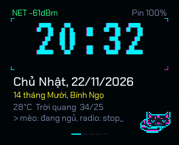
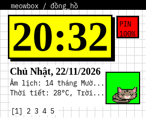

# MeowBox: open firmware for the OSTB xiaozhi-3st speaker

An ESP32-S3 "AI chatbot" speaker sold in Vietnam, freed from its closed-source vendor firmware. It now
runs **MeowBox**, our own firmware: a desk clock with the Vietnamese lunar calendar and weather, alarms,
internet radio (including VOV and YouTube through a PC relay), a notification speaker, a PC companion
screen and a pixel-art virtual cat, all configured from a web page on the speaker, in four UI themes.

This repo also documents the hardware (reverse-engineered, no schematic) so the board can be reused for
other projects.

| Swiss (default) | Cyberpunk | Zen | Brutalism |
|---|---|---|---|
|  |  |  |  |

## Repository layout

| Path | What |
|---|---|
| [`firmware/`](firmware/README.md) | **MeowBox** (ESP-IDF 6.1): board layer, audio, streaming player, Wi-Fi + web server, UI themes, apps, web UI |
| [`pc-agent/`](pc-agent/README.md) | Windows companion: PC stats, media keys, YouTube relay, notifications, spoken alerts |
| [`hw/`](hw/) | reusable C headers: every pin/address ([`ostb_xiaozhi_3st.h`](hw/ostb_xiaozhi_3st.h)), LCD init table |
| [`docs/`](docs/) | hardware, pin map, reverse engineering, plans |
| [`tools/`](tools/) | firmware analysis scripts used to reverse-engineer the vendor binary |
| [`legacy/xiaozhi/`](legacy/xiaozhi/README.md) | board port for upstream xiaozhi-esp32 (AI assistant), not in use |
| `logs/` | vendor firmware boot log (evidence for the reverse engineering) |
| `backup/` | full flash dump of the vendor firmware (**local only**, not in git) |

## Docs

| File | Contents |
|---|---|
| [docs/hardware.md](docs/hardware.md) | parts, block diagram, audio path, power |
| [docs/pinmap.md](docs/pinmap.md) | every GPIO with how it was verified, free pins, display geometry |
| [docs/reverse-engineering.md](docs/reverse-engineering.md) | how the pins were dug out of the vendor binary, step by step |
| [docs/plan.md](docs/plan.md) | MeowBox feature plan and status (in Vietnamese) |
| [docs/ui_redesign.md](docs/ui_redesign.md) | UI review, theme system, per-theme rules (in Vietnamese) |
| [docs/agent_rework.md](docs/agent_rework.md) | planned PC agent rework: tray app + installer (in Vietnamese, not started) |
| [firmware/README.md](firmware/README.md) | build, flash, use, regenerate assets, partitions |
| [firmware/web/API.md](firmware/web/API.md) | REST API of the speaker |

## Hardware at a glance

| | |
|---|---|
| MCU | ESP32-S3, 16 MB flash, 8 MB octal PSRAM, no secure boot / flash encryption |
| Audio | ES8311 DAC (I2C 0x18) + ES7210 4-mic ADC (I2C 0x40), full-duplex I2S, amp enable GPIO4 |
| Display | NV3023 SPI TFT 296×240, CST816S touch (I2C 0x15) |
| I2C / I2S | SDA 12, SCL 11 / MCLK 5, BCLK 15, WS 16, DOUT 6, DIN 7 |
| LCD | MOSI 10, SCLK 9, CS 14, DC 8, RST 18, backlight 13 |
| Buttons | volume up 40, volume down 39 (active low), middle button 1 (active high, long press = power off) |
| Power | charge detect 47, battery voltage on 17 (ADC2 CH6) |
| USB | native USB-Serial/JTAG; flashing needs no buttons |

## Quick start

```powershell
# in an ESP-IDF 6.1 shell (or: . $env:IDF_PATH\export.ps1 / source $IDF_PATH/export.sh)
cd firmware
idf.py build
idf.py -p COM10 -b 921600 flash
```

Replace `COM10` with your serial port. Then open `http://meowbox.local` (login `admin` / `meowbox`). Details: [firmware/README.md](firmware/README.md).

**Before flashing a new device, back it up** so the vendor firmware can be restored:

```powershell
python -m esptool --port COM10 -b 921600 read-flash 0 ALL backup\speaker_full_16MB.bin   # backup
python -m esptool --port COM10 -b 921600 write-flash 0 backup\speaker_full_16MB.bin      # restore
```

## Status and open items

- [x] Hardware fully mapped and checked on the device (sound, display, touch, buttons, battery)
- [x] MeowBox: clock, lunar calendar, weather, alarms, radio, notifications, PC screen, cat, battery log, 4 themes
- [ ] Measure the visible screen area (System tile → long-press the title) and set `UI_SAFE_X/Y`
- [ ] Run the battery flat once to calibrate the % scale; power saving
- [ ] Night palette for the cat; mini game; ntfy.sh; FPS measurement
- [ ] Internal RAM is tight while streaming (~8 KB minimum free); optimise before adding big features
- [ ] Find out which "free" GPIOs actually reach pads on the PCB

## Licences

MeowBox code, docs, tools and the cat sprites (original pixel art) are released under the
[MIT License](LICENSE). Third-party parts keep their own licences:

| Part | Licence |
|---|---|
| Fonts in `firmware/tools/fonts/src/` and the fonts generated from them (`firmware/components/fonts/`, `firmware/storage/web/fonts/`): Be Vietnam Pro, Archivo, Chakra Petch, VT323, Cormorant Garamond, Noto Serif JP (one glyph), IBM Plex Mono, Tinos, JetBrains Mono | SIL Open Font License 1.1 (each font folder has its `OFL.txt`) |
| Font Awesome symbols merged into the UI fonts (from LVGL) | SIL OFL 1.1 (Font Awesome Free) |
| `legacy/xiaozhi/` patch against [xiaozhi-esp32](https://github.com/78/xiaozhi-esp32) | MIT (upstream) |
| ESP-IDF and the managed components (LVGL, esp_codec_dev, esp_audio_codec, ...) | fetched at build time under their own licences, not included here |

This project is not affiliated with the speaker's vendor. No vendor firmware is included; the reverse
engineering notes describe how the hardware is wired so it can run other software.
