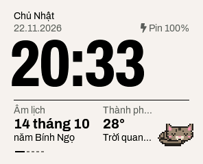
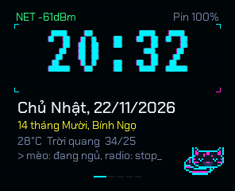
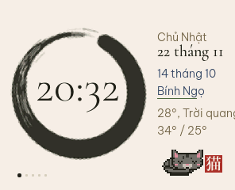
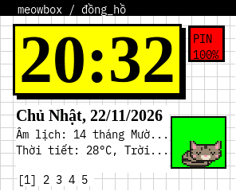

# Hướng dẫn dùng loa MeowBox

Hướng dẫn cho người dùng loa đã cài firmware MeowBox (loa OSTB xiaozhi-3st). Cách build và nạp firmware xem
[README.md](README.md) và [firmware/README.md](firmware/README.md).

MeowBox biến chiếc loa thành:
- đồng hồ để bàn có âm lịch và thời tiết;
- báo thức;
- radio internet (VOV, các đài trên thế giới, YouTube qua máy tính);
- loa đọc thông báo;
- màn hình phụ cho máy tính;
- chú mèo Meow Coding: mèo "code" cùng Claude Code trên máy tính và báo khi cần bạn.

Mọi cài đặt làm trên trang web của loa.

| Swiss | Cyberpunk | Zen | Brutalism |
|---|---|---|---|
|  |  |  |  |

## 1. Cài đặt lần đầu

1. Bật loa. Chưa có Wi-Fi nào quen thì loa tự phát Wi-Fi cài đặt tên **`MeowBox-XXXX`** (XXXX là 4 ký tự riêng của
   từng loa) và hiện một **mã QR** trên màn hình.
2. Mở camera điện thoại (hoặc Zalo) và quét mã: điện thoại tự vào Wi-Fi đó, không cần gõ mật khẩu. Trang cài đặt
   thường tự mở. Không thấy thì quét mã thứ hai hiện trên loa (hoặc mở `http://192.168.4.1`).
   Muốn vào bằng tay: mật khẩu ghi cạnh mã QR (mỗi loa một mật khẩu riêng). Chạm vào màn hình để ẩn mã.
3. Chọn Wi-Fi nhà, nhập mật khẩu. Loa nối mạng, rồi khoảng 10 giây sau Wi-Fi cài đặt tự tắt.
   Nếu không ai dùng, Wi-Fi cài đặt cũng tự tắt sau 10 phút.
4. Mở trang web của loa (mục 3). Lần đầu đăng nhập, trang web bắt **đổi mật khẩu** rồi mới cho dùng.

Mở lại Wi-Fi cài đặt khi đổi mạng hoặc mang loa đi chỗ khác:
- giữ cùng lúc **VOL+** và **VOL−** trong 3 giây;
- hoặc vào màn Hệ thống trên loa, chọn "Wi-Fi";
- hoặc vào trang Wi-Fi trên web.

Mất Wi-Fi quá 5 phút (ví dụ đổi router) thì loa tự mở Wi-Fi cài đặt trong lúc vẫn thử nối lại.

Loa nhớ nhiều mạng Wi-Fi. Mỗi lần khởi động, nó thử trước các mạng đang có sóng, theo thứ tự bạn xếp trên web.

## 2. Trên loa

Vuốt trái/phải để đổi màn: **Đồng hồ → Radio → Máy tính → Mèo → Hệ thống**. Khi chưa có máy tính nào nối loa
thì màn Máy tính được bỏ qua: vuốt từ Radio sang thẳng Mèo.

| Nút | Bấm | Ghi chú |
|---|---|---|
| Nút giữa | chỉ là nút nguồn | **giữ lâu: tắt nguồn**. Bấm nhanh không làm gì |
| VOL+ / VOL− | tăng/giảm âm lượng 5 nấc, giữ để tăng/giảm liên tục | lúc báo thức kêu: bấm = báo lại, giữ khoảng 1 giây = tắt |
| VOL+ và VOL− cùng lúc, giữ 3 giây | mở Wi-Fi cài đặt | |

- **Đồng hồ**: giờ, ngày dương và âm lịch, thời tiết. Chạm vào góc có con mèo để sang màn Mèo.
- **Radio**: đài đang phát, tên bài, mức đệm. Khi đang tải hiện "Đang tải N%".
- **Máy tính**: CPU, RAM, GPU, nhiệt độ, mạng của máy tính, bài đang phát và các nút ⏮ ⏯ ⏭. Cần cài PC agent (mục 7).
- **Mèo**: mục 8.
- **Hệ thống**:
  - Wi-Fi và địa chỉ web của loa, dạng `meowbox-xxxx.local` và IP;
  - pin và thời gian còn lại;
  - phiên bản, kèm thông báo khi có bản mới;
  - lúc phát radio thì hiện số liệu: tốc độ tải, độ dài đệm, số lần ngắt;
  - phần thử mic.

## 3. Trang web của loa

Mở `http://meowbox-xxxx.local` (4 ký tự giống tên Wi-Fi cài đặt), hoặc IP hiện trên màn Hệ thống. Điện thoại hoặc
máy tính phải cùng mạng Wi-Fi với loa.

- Đăng nhập mặc định: **`meowbox`** / **`m3owb0x2026`**. Còn dùng mật khẩu này thì trang web chỉ hiện ô đổi mật khẩu.
  Đổi lại sau ở trang Hệ thống.
- Nhập sai mật khẩu 5 lần thì máy đó phải chờ 30 giây mới thử lại được, sai tiếp thì chờ lâu hơn (tối đa 15 phút).
  Máy khác vẫn đăng nhập bình thường.
- Một số Android và mạng công ty không mở được tên `.local`: dùng IP.
- Trang web có tiếng Việt và tiếng Anh. Giao diện trang web đổi theo theme của loa.

| Trang | Làm gì |
|---|---|
| Tổng quan | trạng thái loa, pin, màn hình loa (ảnh chụp thật, tự cập nhật) |
| Radio | danh sách đài, tìm đài, phát/dừng, âm lượng, hẹn giờ tắt |
| Báo thức | thêm/sửa báo thức |
| Mèo | các phiên Claude Code đang chạy, giới hạn 5 giờ và tuần; tên mèo, màu lông, gọi sen, âm thanh, vỗ tay |
| Thông báo | token, gửi thử, lịch sử 20 tin gần nhất |
| Máy tính | trạng thái PC agent, địa chỉ relay YouTube |
| Cài đặt → Giao diện | theme, chế độ đêm, độ sáng ban đêm, hiệu ứng, ngôn ngữ trên loa |
| Cài đặt → Wi-Fi | các mạng đã lưu, thứ tự ưu tiên, Wi-Fi cài đặt |
| Cài đặt → Thời tiết | thành phố, bật/tắt thời tiết trên đồng hồ |
| Cài đặt → Hệ thống | đổi mật khẩu, cập nhật firmware, khởi động lại, xoá dữ liệu, khôi phục cài đặt gốc, xem **nhật ký lỗi** |

## 4. Radio

- **Thêm đài**: ở trang Radio, tìm theo tên hoặc thể loại (dữ liệu từ Radio Browser), bấm "Nghe thử", rồi thêm vào
  danh sách. Có link stream sẵn thì dùng "Thêm đài bằng link" (link bắt đầu bằng `http://` hoặc `https://`).
- **Loại đài loa phát được**: MP3, AAC, HLS (`.m3u8`, ví dụ VOV), danh sách `.pls`/`.m3u`. Link YouTube (video,
  playlist, live) cần máy tính bật PC agent (mục 7).
- Đài phát theo thứ tự trong danh sách.
- **Hẹn giờ tắt**: 15, 30, 60, 90 phút hoặc tự chọn. Hết giờ thì radio tắt.
- **Wi-Fi yếu hoặc lạ** (quán cà phê, khách sạn):
  - loa tự tắt tiết kiệm điện Wi-Fi trong lúc phát;
  - bị ngắt thì loa tự tăng bộ đệm lên 6 rồi 10 giây;
  - máy chủ đài trả dữ liệu quá chậm thì loa tự nối lại.

  Muốn biết vì sao bị ngắt thì xem số liệu trên màn Hệ thống hoặc trang Radio. Tốc độ tải thấp hơn bitrate của đài
  nghĩa là mạng không đủ nhanh cho đài đó.

## 5. Báo thức

- Mỗi báo thức có giờ, các ngày trong tuần, âm thanh và số phút báo lại.
- Trên trang Báo thức, giờ nhập theo kiểu 24 giờ (ví dụ `06:30`, `18:45`). Thêm hoặc sửa xong thì bấm **Lưu**,
  rời trang mà chưa lưu thì thay đổi bị bỏ.
- Âm thanh là chuông có sẵn, hoặc một đài radio trong danh sách. Đài không phát được thì loa tự dùng chuông.
- Lúc báo thức kêu:
  - giữ VOL+ hoặc VOL− khoảng 1 giây để tắt;
  - bấm VOL+ hoặc VOL−, hoặc chạm màn hình, để báo lại sau số phút đã đặt.

## 6. Thông báo

Loa hiện thông báo lên màn hình và kêu như mèo: "mrrp?" cho thông báo thường, hai tiếng "meo!" gắt cho thông báo
khẩn (`alert`). Báo thức cũng là tiếng mèo đòi ăn sáng. Đang phát radio thì nhạc vẫn chạy, chỉ nhỏ đi trong lúc kêu. Thông báo gửi được từ bất kỳ máy nào trong mạng, ví dụ script, máy
chủ hay Home Assistant. Mỗi lần gửi cần **token** lấy ở trang Thông báo.

```bash
curl "http://meowbox-xxxx.local/api/notify?token=TOKEN&title=Build&text=Xong%20roi"
curl -H "Authorization: Bearer TOKEN" -H "Content-Type: application/json" \
     -d '{"title":"Server","text":"CPU 95%","sound":"alert","priority":"high"}' http://meowbox-xxxx.local/api/notify
```

- **Mức ưu tiên**:
  - `high`: màu đỏ, màn hình sáng lên dù đang ban đêm;
  - `normal`: mặc định;
  - `low`: không kêu vào ban đêm, có thể tắt ở trang Thông báo.
- Từ máy tính có PC agent:
  - `meowbox notify "Tiêu đề" "Nội dung"`;
  - `meowbox say "Build xong rồi nha"`: đọc thành tiếng bằng giọng Windows.
- Lỡ token thì tạo token mới ở trang Thông báo. Token cũ hết dùng được.

Đầy đủ các tham số: [firmware/web/API.md](firmware/web/API.md).

## 7. Máy tính (PC agent, Windows)

1. Tải `MeowBoxAgent-Setup-x.y.z.exe` ở
   [Releases](https://github.com/phuc4real/meowbox-esp32/releases/latest) rồi chạy.
   Windows có thể báo "Unknown publisher": bấm *More info → Run anyway*.
2. Cài xong, icon con mèo hiện ở khay hệ thống và cửa sổ **Kết nối loa** tự mở. Nhập IP của loa (xem ở tile Hệ thống
   trên màn hình loa), dán token (bắt buộc, lấy ở trang Thông báo) và bấm Kiểm tra, rồi kiểm tra loa có gọi được
   máy tính không. Loa đổi IP thì mở lại
   **Kết nối loa** trong menu và nhập IP mới.
3. Ý nghĩa chấm trên icon:
   - xanh: đã nối loa;
   - xám: đang nối loa;
   - đỏ: có lỗi, di chuột vào icon để xem lỗi gì.

Agent gửi số liệu máy và bài đang phát lên màn Máy tính, nhận lệnh ⏮ ⏯ ⏭ và âm lượng từ loa, và làm relay cho
YouTube. Mỗi loa chỉ nhận một máy tính mỗi lúc. Muốn đổi sang máy khác thì chọn "Giành quyền nối loa" trong menu.

Chi tiết: [pc-agent/README.md](pc-agent/README.md).

## 8. Mèo (Meow Coding)

Màn Mèo cho biết Claude Code đang làm gì trên máy tính. Cần PC agent (mục 7) và bật **Meow Coding (Claude Code)**
trong menu ở khay hệ thống. Các phiên Claude Code mở sau đó sẽ hiện lên loa.
- Mèo gõ laptop khi Claude Code đang làm, giơ dấu "?" khi nó cần bạn (hỏi quyền hoặc hỏi một câu), và vui khi xong.
- Bên cạnh mèo: tên phiên, việc đang làm ("đang đọc file", "đang chạy bash"...), đã bao lâu, context đã dùng, số
  token và giới hạn 5 giờ của gói Claude.
- Khi Claude Code cần bạn, loa tự mở màn Mèo, bật màn hình và kêu chuông. Xong việc thì mèo kêu "meo" (ban đêm không
  kêu). Tắt được ở trang Mèo ("Gọi sen" và "Âm thanh").
- Có nhiều phiên thì chạm vào phần chữ để xem phiên tiếp theo. Chạm vào mèo thì nó kêu "meo".
- Vỗ tay to một cái khi đang mở màn Mèo thì mèo giật mình nhảy lên. Loa chỉ đo độ to, không ghi âm; tắt được ở
  trang Mèo.
- Đặt tên và màu lông ở trang Mèo.
- Loa chỉ nhận nhãn ngắn (tên phiên, thư mục, nhánh, loại việc), không nhận nội dung bạn gõ, lệnh hay file.

## 9. Giao diện

- **4 theme**: Swiss (mặc định), Cyberpunk, Zen, Brutalism. Theme nào cũng có bản ban đêm.
- **Chế độ đêm**: đổi sang bản ban đêm của theme và giảm độ sáng. Mặc định tự bật từ 22 giờ tới 7 giờ; có thể đổi
  giờ, để luôn bật hoặc tắt hẳn.
- **Hiệu ứng**: "đầy đủ" hoặc "tiết kiệm". Tiết kiệm thì tắt lệch màu, scanline, khối nghiêng. Chế độ này tự bật khi
  loa chạy pin.
- **Ngôn ngữ trên loa**: tiếng Việt hoặc tiếng Anh, không phụ thuộc ngôn ngữ của trang web.

## 10. Pin

- **Tắt màn hình**: không bấm nút hay chạm vào loa 5 phút thì màn tắt hẳn cho đỡ tốn pin. Wi-Fi, báo thức, thông
  báo và nhạc đang phát vẫn chạy; có báo thức hay thông báo thì màn tự bật. Bấm nút bất kỳ hoặc chạm vào màn để bật
  lại; lần bấm hay chạm đó chỉ bật màn, không làm gì khác. Đổi thời gian (hoặc tắt tính năng) ở *Cài đặt → Giao diện*.
  Đang cắm sạc thì màn không tắt (chỉ tối bớt); rút sạc ra thì 5 phút sau mới tắt.
- Rút sạc ra dùng bình thường. Loa ghi pin mỗi phút và ước tính thời gian còn lại. Số này hiện trên đồng hồ, màn Hệ
  thống và trang Tổng quan.
- Loa nhớ 10 lần dùng pin gần nhất: dùng bao lâu, tốn bao nhiêu %, đầy pin thì dùng được bao lâu.
- Pin dưới 30% mà không cắm sạc thì loa không cho cập nhật firmware.

## 11. Cập nhật firmware

1. Vào trang web, chọn **Cài đặt → Hệ thống → Kiểm tra ngay**. Loa chỉ hỏi GitHub khi bạn bấm nút này, trừ khi bật
   "Tự kiểm tra bản mới mỗi ngày".
2. Có bản mới thì bấm **Cập nhật ngay**. Loa tải về, kiểm tra file, rồi tự khởi động lại, mất khoảng 1–2 phút.
   **Đừng tắt loa trong lúc đó.**
3. Bản mới không chạy được thì loa tự quay về bản cũ, và trang web báo lại.

Cài đặt, Wi-Fi, đài và báo thức đều được giữ nguyên.

Loa còn chạy bản 0.1.0 thì chưa có nút cập nhật. Tải file `meowbox-x.y.z.bin` ở Releases, rồi tải lên ở mục
**Cập nhật firmware** trên trang web.

## 12. Gặp sự cố

| Hiện tượng | Thử |
|---|---|
| Không mở được `meowbox-xxxx.local` | dùng IP trên màn Hệ thống; kiểm tra điện thoại có cùng Wi-Fi với loa |
| Quên mật khẩu web | hai nút xoá trên web đều cần đăng nhập, nên phải xoá phân vùng `data` qua cáp USB (xem [firmware/README.md](firmware/README.md)); loa về mật khẩu mặc định |
| Loa không vào được Wi-Fi mới | mở Wi-Fi cài đặt (giữ VOL+ và VOL− 3 giây) và nhập lại |
| Radio hay ngắt | xem số liệu ở màn Hệ thống: tốc độ tải thấp hơn bitrate là do mạng. Thử đài bitrate thấp hơn (64 kbps) |
| YouTube không phát | máy tính phải bật PC agent và đã nối loa. Trong cửa sổ Kết nối loa có bước kiểm tra relay. Mạng Windows đặt là Public thì bấm "Cho phép trên mạng này" |
| Màn PC trống | agent chưa chạy hoặc đang nối loa khác: xem icon con mèo ở khay hệ thống |
| Loa tự khởi động lại, hoặc màn bị đứng một lúc | **Cài đặt → Hệ thống → Nhật ký lỗi**: lý do khởi động lại lần trước và các lỗi ngay trước đó (mất khi rút điện). Gửi kèm phần này khi báo lỗi |

Hai nút ở **Cài đặt → Hệ thống**, phải đăng nhập mới dùng được. Bấm xong, trang web hỏi lại một lần nữa rồi mới làm:

| Nút | Xoá | Giữ lại |
|---|---|---|
| **Xoá dữ liệu** | lịch sử pin, lịch sử thông báo | cài đặt, Wi-Fi, đài, báo thức, mật khẩu, token |
| **Khôi phục cài đặt gốc** | tất cả, kể cả mật khẩu và token | không giữ gì: loa quay về Wi-Fi cài đặt `MeowBox-XXXX` như lúc mới |
